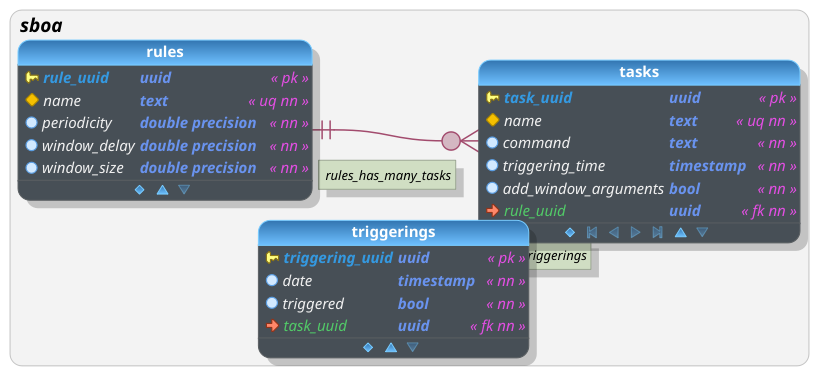

# SBOA: Scheduling management for Business Operation Analysis

SBOA is the scheduling component of the BOA suite. It schedules recurring
commands and records their triggerings in PostgreSQL.

## Database model



## Repository structure

The layout follows the conventions of the BOA suite:

```text
src/
  sboa/
    common/        # Standalone command execution helpers
    config/        # Logging, database and scheduler configuration templates
    datamodel/     # SQLAlchemy models and PostgreSQL SQL model
    engine/        # Scheduler configuration and query API
    scheduler/     # Scheduler daemon and task execution
    schemas/       # Scheduler XML schema
    scripts/       # Database initialization and development startup
  tests/
    unit/          # Database-free tests for scheduling, CLI and failure paths
    integration/   # PostgreSQL query, persistence and scheduling tests
    xml_inputs/    # Scheduler test fixtures
doc/publishing.md
tools/            # Distribution and installed-resource checks
```

Package metadata lives in the root `pyproject.toml`. Runtime assets are bundled
inside `sboa`; tests stay in `src/tests` and are excluded from distributions.

## Install

Install SBOA and its test dependencies from this checkout:

```bash
python -m pip install -e '.[tests]'
```

The distribution provides `sboa_init.py`, `sboa_init_ddbb.sh`,
`boa_scheduler.py` and `boa_execute_triggering.py`, as well as the development
helpers `initialize_sboa_ddbb.sh` and `start_sboa.sh`. SQL models, schemas and
configuration templates can be located with `importlib.resources.files("sboa")`.

## Configuration

Configure a writable SBOA resource directory for scheduler configuration and state:

```bash
export SBOA_DATA_PATH="$(python -c 'from importlib.resources import files; print(files("sboa"))')"
export SBOA_RESOURCES_PATH="$PWD/sboa-state"
export SBOA_SCHEMAS_PATH="$SBOA_DATA_PATH/schemas"
mkdir -p "$SBOA_RESOURCES_PATH"
cp "$SBOA_DATA_PATH"/config/* "$SBOA_RESOURCES_PATH/"
```

`SBOA_RESOURCES_PATH` contains `engine.json`, `sboa_datamodel.json`, `scheduler.xml`, the
`boa_scheduler.pid` file and the `on_going_triggerings/` directory. It defaults
to the bundled `sboa/config` directory, following the BOA suite convention;
set it to a writable directory when running the scheduler from an installed
package. An explicitly configured directory must exist. SBOA configuration and
scheduler state use this variable exclusively.

Logging uses `engine.json` in `SBOA_RESOURCES_PATH`. Set `SBOA_LOG_PATH` to
the log directory (default `/tmp/sboa_log`); SBOA creates it when needed.
`SBOA_LOG_LEVEL`, `SBOA_LOG_MAX_BYTES` and `SBOA_LOG_MAX_BACKUP` override the
JSON logging settings. Set `SBOA_STREAM_LOG` to also log to the console.

Set `SBOA_DDBB_HOST` for the scheduler database host. Initialize it with
`sboa_init.py`. Schemas use `SBOA_SCHEMAS_PATH`, defaulting to the bundled
`sboa/schemas` directory. Explicit schema directories must exist.

Database initializers require the PostgreSQL client (`psql`). They use their
bundled SQL model by default and accept `-f /path/to/model.sql` to override it.
`sboa_init.py` requests confirmation before resetting a database.
`initialize_sboa_ddbb.sh` accepts the reset automatically for development tests.

## Development and tests

Run the database-free tests and regenerate the coverage report from the repository
root after installing the test dependencies:

```bash
python -m pytest -m 'not integration' --cov=sboa --cov-report=term-missing --cov-report=html
```

These tests intercept process creation, daemonization and database initialization
commands. They require no running database server. All database tests use
PostgreSQL and carry the `integration` marker. Coverage measures statements and
branches in every Python module in `sboa`. Open
`src/tests/tmp/code_coverage_analysis/index.html` for the detailed report.
The packaging workflow runs this suite and reports coverage on each supported
CI Python version.

Start the local development environment and run the integration suite from the
repository root:

```bash
UID_HOST_USER=$(id -u) GID_HOST_USER=$(id -g) docker compose -f compose_dev.yml up --build -d --wait
docker compose -f compose_dev.yml exec -T sboa bash -ec 'initialize_sboa_ddbb.sh; cd /sboa; python -m pytest -v src/tests --cov=sboa --cov-report=term-missing --cov-report=html'
docker compose -f compose_dev.yml down -v
```

`Dockerfile.dev` builds the current checkout and installs SBOA in editable mode.
Compose mounts the checkout at `/sboa`, so local source and test edits are visible
immediately. The image installs SBOA and its dependencies directly from
`pyproject.toml`. Rebuild after changing dependencies.
The container runs as the `boa` user with the selected host user and group IDs.
`SBOA_RESOURCES_PATH=/resources_path` holds writable scheduler state and links
to the checkout's SBOA configuration templates.
The database has no published host ports and joins `boa_network`, as in the
other BOA development environments. Tests reset the dedicated `sboadb` database.
The tests marked `integration` use the configured PostgreSQL database, which
must be initialized with the bundled SQL model. They clear scheduler tables
between tests. Scheduler integration tests also execute actual subprocesses.
The full Compose suite runs both database-free and integration tests.

For the GitHub development environment:

```bash
REPOSITORY_URI=https://github.com/danielbrosnan/sboa.git GITHUB_BRANCH=develop \
  docker compose -f compose_github_dev.yml up --build -d --wait
```

`Dockerfile.github.dev` clones the selected SBOA repository and branch.
Keep `REPOSITORY_URI` and `GITHUB_BRANCH` set for subsequent
Compose commands. The `sboa-testing.yml` workflow uses this environment.

With dependencies and configuration available locally, run `python -m pytest`
from the repository root, or `cd src && python -m pytest tests/`.

## Build and publish

```bash
python -m pip install build twine
python -m build
python -m twine check --strict dist/*
python tools/check_distribution.py dist
```

Start with an empty `dist` directory for each build. The wheel and source
distribution contain only SBOA and its runtime assets. The packaging workflow
checks both installed artifacts on Python 3.9 and 3.11. See
[Publishing SBOA](doc/publishing.md) for the release workflow and installed-resource
checks.
